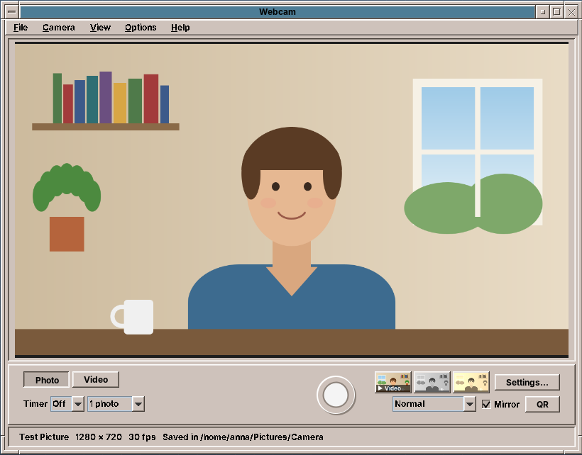
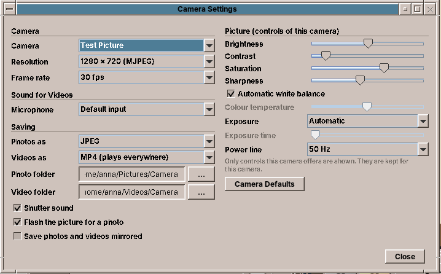

# amade-webcam

**amade-webcam** is the camera program of the [amadeOS](https://github.com/amadeos-eu/amadeos) desktop. It shows the picture of a webcam, takes photos and records videos with sound, reads QR codes and makes time lapses. Built like the other amadeOS applications.




## Features

- **Live picture** of any V4L2 camera (built-in or USB), mirrored like a mirror by default. Cameras that are plugged in or pulled out appear in *Camera* menu and settings within two seconds; the last used camera is chosen again at the next start.
- **Photos** with the round shutter button, Space or Enter: a short flash and a shutter click (both can be switched off), saved as JPEG or PNG in `~/Pictures/Camera` with names like `Photo 2026-10-31 14-05-12.jpg`.
- **Self-timer** of 3 or 10 seconds with a large countdown, and **bursts** of 3 or 5 photos a quarter of a second apart.
- **Videos** with sound from the chosen microphone and a level meter. MP4 (H.264 and AAC, plays on every computer, phone and TV) by default, WebM (VP9 and Opus) in the settings. Saved in `~/Videos/Camera`.
- **A notification** when a photo, a burst or a video is saved while the window is in the background (self-timer, time lapse); *Open* opens the file.
- **Time lapse**: one picture every 1, 5, 10 or 30 seconds, played back at the normal frame rate.
- **Looks**: Normal, Black and White, Sepia, Warm and Cool, live in the picture and in what is saved.
- **QR codes**: with *QR* switched on, a code in front of the camera shows a bar with its content and a fitting button: open a link, write a mail, copy a Wi-Fi password, copy text.
- **Recent pictures**: the newest three photos and videos as small pictures next to the shutter; a click opens one, the right mouse button offers Edit (in the image editor), Show in Folder and Delete.
- **Camera settings** (Ctrl+comma): camera, resolution and frame rate, microphone, file formats and folders, and the picture controls the camera offers (brightness, contrast, saturation, sharpness, white balance, exposure, power line frequency, ...). Controls are kept per camera; *Camera Defaults* resets them.

  
- **Full screen** (F11), a rule-of-thirds **grid** (Ctrl+G), mirror on and off (Ctrl+M). *Save photos and videos mirrored* decides whether files are mirrored too; by default they show the scene the right way round.
- Clear messages when there is no camera, when another program is using it, or when it was pulled out during a recording (what was recorded is kept).
- The Front Panel shows a camera light while a picture is taken from the camera (planned together with amadeos-system).
- Five languages (English, Deutsch, Français, Español, Italiano), following the amadeOS desktop language; *Options → Language* overrides it.
- Theme colours and Motif look from [amade-commons](https://github.com/amadeos-eu/amade-commons).

### Keys

| Key | Action |
|---|---|
| Space, Enter | Take the photo, or start and stop the recording |
| Esc | Cancel the self-timer, leave full screen |
| Ctrl+1, Ctrl+2 | Photo, Video |
| Ctrl+R | Start or stop recording |
| Ctrl+M, Ctrl+G, Ctrl+K | Mirror, grid, QR codes |
| F11 | Full screen |
| Ctrl+comma | Camera settings |
| Ctrl+O | Open the photo folder |

## Platforms

Linux only (deb). The program reads the camera through `ffmpeg` (V4L2) and the camera controls through `v4l2-ctl`; microphones come from PipeWire or PulseAudio (`pactl`).

## Architecture

Java 25, Swing and Guice; start-up, theme and language come from `AmadeApplication` in amade-commons. QR codes are read with [ZXing](https://github.com/zxing/zxing).

| Package | Contents |
|---|---|
| `bootstrap` | `AmadeWebcamApplication` (`--test-picture`), `WebcamModule` |
| `domain` | `CameraDevice`, `VideoMode`, `CameraControl`, `Look`, `CaptureMode`, `PhotoTimer`, `Shots`, `VideoSpeed`, `PhotoFormat`, `VideoFormat`, `FileNames`, `QrContent` |
| `repository` | `WebcamPreferences` (`~/.config/amadeos/webcam/webcam.properties`: camera, mode and controls per camera, folders, formats, options) |
| `service` | `CameraFinder` and `V4l2Output` (devices, formats, controls), `FfmpegCamera` (frames from ffmpeg), `Recorder` (second ffmpeg that encodes frames and sound), `Microphones`, `QrReader`, `PhotoSaver`, `RecentMedia`, `ShutterSound` |
| `ui.main` | window, presenter, menus, `PreviewPanel`, `ShutterButton`, `LevelMeter`, `RecentStrip`, `QrBanner` |
| `ui.settings` | `SettingsDialog` |

One ffmpeg process reads the camera and writes raw BGR frames into a pipe; the window shows each frame and the presenter applies the look. A recording starts a second ffmpeg that gets the same frames on standard input and the sound from PulseAudio, so the preview keeps running while recording. The presenter knows the window only through the `MainView` interface, so the tests drive photos, timers, bursts, recordings and camera changes without Swing.

## Build and run

```sh
./gradlew run                                         # the first camera
./gradlew run --args="--test-picture"                 # a moving test picture, no camera needed
./gradlew run --args="--test-picture=scene.png"       # a still picture as camera
./gradlew test                                        # needs ffmpeg; Swing tests need a display: xvfb-run ./gradlew test
./gradlew deb                                         # build/distributions/amade-webcam_<version>_all.deb
./gradlew installToAmadeOs                            # the .deb into ../amadeos/config/packages.chroot/ for the ISO build
```

If `../amade-commons` is checked out next to this repository, Gradle builds against that checkout instead of the JitPack version.

## Planned

- Background blur and replacement
- Recording the screen together with the camera
- A virtual camera for video calls

## License

[EUPL-1.2](LICENSE)
